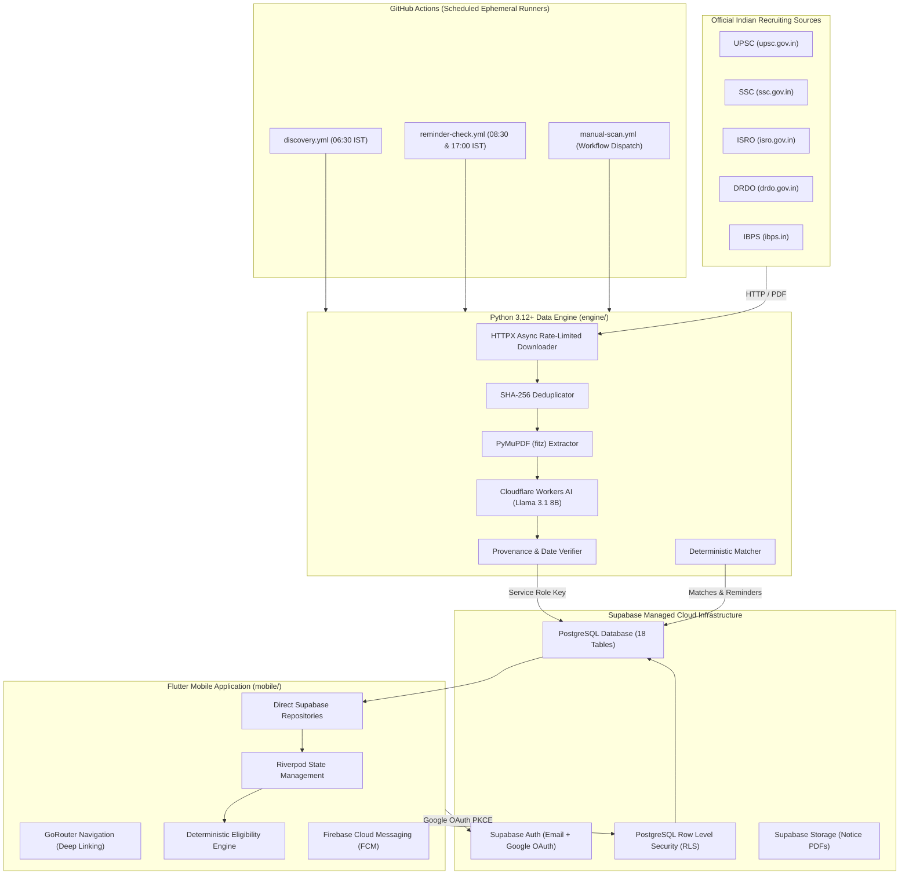
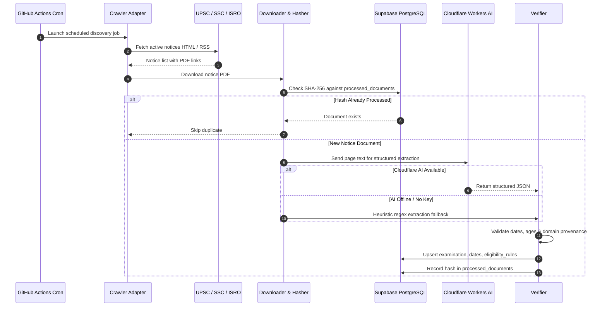

# Rexam — System Architecture Documentation

## 1. Executive Summary & Design Principles

**Rexam** is an India-focused examination, recruitment, higher education, and scholarship intelligence platform. It provides candidates with personalized eligibility discovery, milestone tracking, and official notification alerts.

### Core Architectural Principles:
1. **Zero-VPS Operational Model**: No perpetually running servers (such as FastAPI, Express, or Django instances on VPS/Render/Railway). Compute is executed either on-device (Flutter client) or via ephemeral scheduled runners (GitHub Actions).
2. **Direct-to-Database Security via RLS**: The Flutter client connects directly to Supabase PostgreSQL using `supabase_flutter`. Access control is strictly enforced at the database kernel level through PostgreSQL Row Level Security (RLS) policies tied to `auth.uid()`.
3. **Deterministic Eligibility Over Probabilistic AI**: Statutory Indian eligibility criteria (age cutoffs, category relaxations for OBC-NCL, SC, ST, PwBD, Ex-Servicemen, required degree streams, aggregate percentage minimums, active backlogs) are evaluated 100% deterministically in compiled code. AI is never invoked for ordinary searching, filtering, or eligibility decisions.
4. **Resilient AI-Assisted Document Ingestion**: Cloudflare Workers AI is used as an optional document extraction provider for complex PDF notifications. If AI is unavailable, rate-limited, or unconfigured, the system automatically falls back to regex-based heuristic extraction and flags the record as `under_review`.
5. **Absolute Secret Isolation**: Service-role keys and Cloudflare AI tokens are restricted strictly to GitHub Actions / Python ingestion jobs. The Flutter application bundle contains only public client-safe keys (`anonKey`/`publishableKey`).

---

## 2. High-Level System Architecture Diagram

---

## 3. Component Details

### 3.1 Mobile Client (`mobile/`)
- **Framework**: Flutter 3.47+ / Dart 3.13+
- **Theme**: Dark obsidian aesthetic (`#090D0B`, `#111713`, `#171F19`) with muted natural green accents (`#65D68A`, `#328653`) and Inter typography.
- **State Management**: Riverpod (`StateNotifierProvider`, `FutureProvider`).
- **Routing**: `go_router` with deep-linking handler `io.supabase.rexam://login-callback`.
- **Database Client**: `supabase_flutter` with PKCE auth flow.
- **Offline / Graceful Degradation**: Contains authentic fallback datasets for all 6 major Indian opportunity domains, allowing full exploration even when disconnected or during backend maintenance.

### 3.2 Python Data Engine (`engine/`)
- **Runtime**: Python 3.12+
- **Extraction**: `PyMuPDF` (`fitz`) for PDF text layer extraction; `BeautifulSoup4` for HTML notice tables.
- **AI Extraction Client**: Cloudflare Workers AI REST API invoking `@cf/meta/llama-3.1-8b-instruct`.
- **Deduplication**: SHA-256 cryptographic hashing against `processed_documents` to eliminate redundant AI calls.
- **Verification**: Verifies top-level domains against `.gov.in`, `.nic.in`, `.ac.in`, `.res.in`, checks chronological ordering of opening/closing/exam dates, and enforces age ranges.

### 3.3 Database Layer (`supabase/`)
- **Database**: Supabase PostgreSQL 15+.
- **Tables (18)**:
  - Identity & Profile: `profiles`, `candidate_education`, `candidate_preferences`.
  - Opportunity Repository: `organisations`, `sources`, `examinations`, `examination_dates`, `eligibility_rules`, `examination_documents`, `examination_updates`.
  - Candidate Activity: `saved_examinations`, `candidate_followed_examinations`, `candidate_applications`, `notifications`, `device_tokens`, `candidate_matches`.
  - Operational Tracking: `crawler_runs`, `processed_documents`.
- **Security**: PostgreSQL Row Level Security (RLS) is enabled on all tables. Authenticated users can only read/write their own records (`auth.uid() = candidate_id`). Examinations in `published` status are readable by all authenticated and anonymous candidates.

---

## 4. Ingestion Lifecycle & Data Flow

